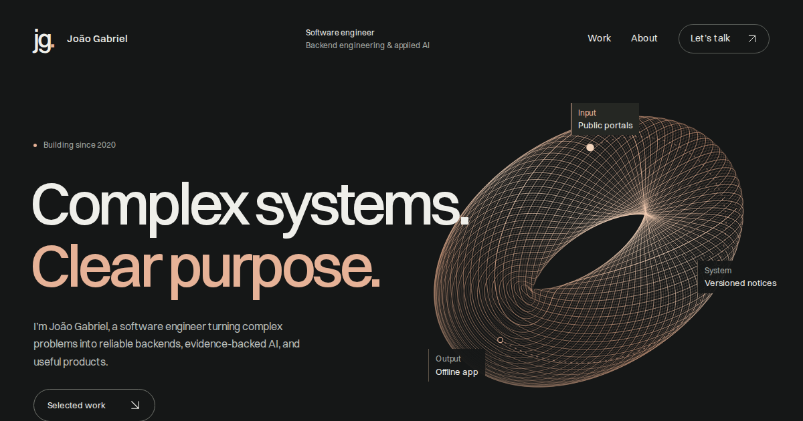

# João Gabriel · Portfolio

**Complex systems. Clear purpose.**

My engineering portfolio connects backend systems, applied AI, and useful products through an interactive input → system → output flow. It includes four project case studies, professional experience, education, credentials, and open-source contributions.

[GitHub profile](https://github.com/Gabrieljr42) · [LinkedIn](https://www.linkedin.com/in/joao-gabriel-alves-junior/)



## Featured work

- **[Pensieve](https://github.com/Gabrieljr42/ThePensive)**: an evidence-backed research archive comparing RAG and full-context prompting.
- **[Observador de Concursos](https://github.com/Gabrieljr42/ObservadorConcursos)**: public-notice collection, document versioning, and offline-first mobile synchronization.
- **[Android Fitness Ecosystem](https://github.com/Gabrieljr42/android-fitness-ecosystem)**: connected, local-first training, nutrition, and coaching apps.
- **[GymIA](https://github.com/Gabrieljr42/GymIA)**: an academic prototype for AI-assisted workout planning with instructor review.

The background page covers my work at Grupo Actcon and ECOM-D, Information Systems degree at IFMG, ongoing postgraduate studies in Generative AI & Large Language Models at PUC-Rio, and three Alura credentials linked to their issuer pages.

## Stack

Astro and TypeScript generate static HTML. GSAP and Lenis enhance the site with a single animation clock, page transitions, and a procedural SVG sculpture. Content remains readable without JavaScript, with keyboard controls, visible focus, reduced-motion alternatives, and responsive WebP images. Fonts are hosted locally.

## Local development

Use Node.js **22.22 or newer** and npm.

```sh
git clone https://github.com/Gabrieljr42/joao-gabriel-portfolio.git
cd joao-gabriel-portfolio
npm ci
npm run dev -- --background
```

Astro prints the local URL. Manage the background server with `npx astro dev status`, `npx astro dev logs`, and `npx astro dev stop`.

```sh
npm run check
npm run build
npm run preview -- --background --port 4477
```

The production output is `dist/`. Manage the preview with `npx astro preview status`, `npx astro preview logs`, and `npx astro preview stop`.

## Vercel deployment

The repository includes `vercel.json` with the Astro framework preset, `npm ci`, `npm run build`, and `dist/` output. This is a static site; no database, runtime secrets, or server adapter are required.

Import this GitHub repository into Vercel with the repository root as the project root and `main` as the production branch. Once linked, Vercel can build previews for pull requests and production deployments for pushes to `main`.

Canonical URLs, the sitemap, robots, Open Graph, and structured data all share Astro’s configured production origin:

1. `SITE_URL`, when explicitly supplied, takes priority.
2. Otherwise, Vercel’s `VERCEL_PROJECT_PRODUCTION_URL` supplies the production host, including on preview builds.
3. Local builds use `http://localhost:4477`.

Keep Vercel’s **Automatically expose System Environment Variables** setting enabled, or set `SITE_URL` explicitly to the confirmed HTTPS origin. Production builds fail if neither source is available, so a temporary local domain cannot accidentally become the live canonical URL. For a custom domain, set `SITE_URL` and redeploy.

See [Vercel system environment variables](https://vercel.com/docs/environment-variables/system-environment-variables) and [Astro’s Vercel guide](https://docs.astro.build/en/guides/deploy/vercel/).

**Deployment status:** the source is pushed to this private GitHub repository. Vercel deployment is awaiting access to the owner’s `gabrieljr42s-projects` team. The preferred project name is `gabrieljr`, targeting `gabrieljr.vercel.app` if Vercel can assign it; that address has not been reserved or published. A verified live link will be added after deployment succeeds.

## Editing guide

- `src/data/site.ts`: biography, contact, projects, case studies, experience, education, and credentials.
- `src/pages/`: homepage, background page, project routes, robots, and designed 404.
- `src/styles/site.css`: visual system and responsive layouts.
- `src/components/Signal.astro`: procedural SVG sculpture and data-flow labels.
- `src/motion/setup.ts`: GSAP interactions and page transitions.
- `astro.config.mjs`: production origin and sitemap.
- `DESIGN.md`: concept and design decisions.
- `CONTENT_SOURCES.md`: project and professional-information provenance.
- `QA.md`: verification results and independent critique.

## Verification

```sh
npm run check
npm run build
```

The production site was checked across desktop, mobile, keyboard, and reduced-motion states. Twenty-five additional browser journeys covered all four cases, data-flow traces, credential links, image inspection, navigation, and real 404 behavior. The independent evidence-only review scored **8.0/10**; this is a rubric estimate, not an official Awwwards award.

Optional local browser verification, with the production preview running:

```sh
npx playwright install chromium
node scripts/check-interactions.mjs http://127.0.0.1:4477
```

Screenshots and browser reports are local QA evidence, excluded from Git. See `QA.md` for measured performance, coverage, and known limits.

## Content and credits

Case studies paraphrase my public project READMEs. Screenshots and existing screen overviews come from my own projects. Professional background and education follow my LinkedIn profile as checked on 20 October 2026. The PUC-Rio program is in progress, expected October 2027. Certificate links point to Alura; no unavailable diploma files are presented as downloads.

Typography: [Switzer by Fontshare](https://www.fontshare.com/fonts/switzer) and [JetBrains Mono](https://www.jetbrains.com/lp/mono/), served as local WOFF2 files. The woven sculpture is procedural SVG art.
